# ERD — D1 (SQLite)

> Nguồn: `worker/migrations/0001..0004`. Id phần tử/công thức là băm (ADR 0002). Thời gian `INTEGER` epoch ms UTC.
> Không có khóa ngoại từ dữ liệu người chơi sang `element`/`recipe`: nội dung đổi theo version, bảng người chơi chỉ giữ id.

```mermaid
erDiagram
  app_meta {
    TEXT key PK "schema, current_version"
    TEXT value
    INTEGER updated_at
  }

  element {
    TEXT id PK
    TEXT name
    TEXT name_fold UK
    TEXT emoji
    INTEGER depth
    TEXT origin
    TEXT image_key
    INTEGER first_version
    INTEGER last_version
  }
  recipe {
    TEXT id PK "khóa tra cứu cặp"
    TEXT a_id FK
    TEXT b_id FK
    TEXT result_id FK
    INTEGER score
    INTEGER first_version
    INTEGER last_version
  }
  batch_run {
    TEXT id PK
    INTEGER version UK
    INTEGER batch_at
    TEXT mode
    TEXT status
    TEXT failed_step
    INTEGER rollback_to
    TEXT daily_element_id
    TEXT stats_json
    TEXT issue_url
  }
  batch_content {
    INTEGER version PK
    INTEGER batch_at
    TEXT day
    TEXT manifest_json
    TEXT graph_json
    TEXT server_json
  }
  block {
    TEXT kind PK
    TEXT target_id PK
    TEXT state
    TEXT reason
    INTEGER created_at
  }
  banned_term {
    TEXT term_fold PK
    TEXT source PK
    INTEGER created_at
  }

  player {
    TEXT id PK "UUID v4"
    TEXT nickname
    TEXT nickname_fold UK
    INTEGER created_at
  }
  consent {
    TEXT id PK
    TEXT player_id
    TEXT purpose
    TEXT action
    INTEGER policy_version
    BLOB ip_hash
    TEXT channel
    INTEGER created_at
  }
  discovery {
    TEXT element_id PK
    TEXT player_id "NULL sau khi xóa"
    TEXT a_id
    TEXT b_id
    INTEGER version
    INTEGER discovered_at
  }
  daily_result {
    INTEGER version PK
    TEXT player_id PK
    TEXT day
    INTEGER steps
    TEXT path_json
    INTEGER submitted_at
  }
  streak {
    TEXT player_id PK
    INTEGER current
    INTEGER longest
    TEXT last_day
    INTEGER reached_at
  }
  report_target {
    TEXT kind PK
    TEXT target_id PK
    INTEGER cycle
  }
  report {
    TEXT id PK
    TEXT kind
    TEXT target_id
    INTEGER cycle
    TEXT player_id
    TEXT reason
    TEXT note
    TEXT status
    INTEGER created_at
  }
  vote {
    TEXT recipe_id PK
    TEXT player_id PK
    TEXT value
    INTEGER updated_at
  }
  event {
    TEXT id PK
    TEXT player_id
    TEXT type
    TEXT props_json
    TEXT day
    INTEGER received_at
  }

  rate_counter {
    TEXT bucket PK
    INTEGER count
    INTEGER expires_at
  }
  admin_audit {
    TEXT id PK
    TEXT action
    TEXT target_kind
    TEXT target_id
    TEXT before_state
    TEXT after_state
    TEXT reason
    TEXT token_fp
    INTEGER created_at
  }

  element ||--o{ recipe : "a / b / result"
  batch_content ||--|| batch_run : "version"
  element ||--o| discovery : "element_id"
  player ||--o{ consent : "player_id (giữ sau khi xóa)"
  player ||--o{ daily_result : "player_id"
  player ||--o| streak : "player_id"
  player ||--o{ report : "player_id"
  player ||--o{ vote : "player_id"
  player ||--o{ event : "player_id"
  report_target ||--o{ report : "kind, target_id, cycle"
  element ||--o| block : "kind = element | image"
  recipe ||--o| block : "kind = recipe"
```

## Ghi chú
- Dữ liệu cá nhân: `player`, `consent`, `discovery.player_id`, `daily_result`, `streak`, `report.player_id`, `vote`, `event` (BRD 5.2). Xóa theo UUID: AC-PRIV-05.
- Giữ dữ liệu (Cron Trigger hằng ngày, ADR 0004): `event` 90 ngày; `consent.ip_hash` 7 ngày; `admin_audit` 12 tháng; `consent` 1 năm sau dòng `erase`; `batch_content` 14 version mới nhất.
